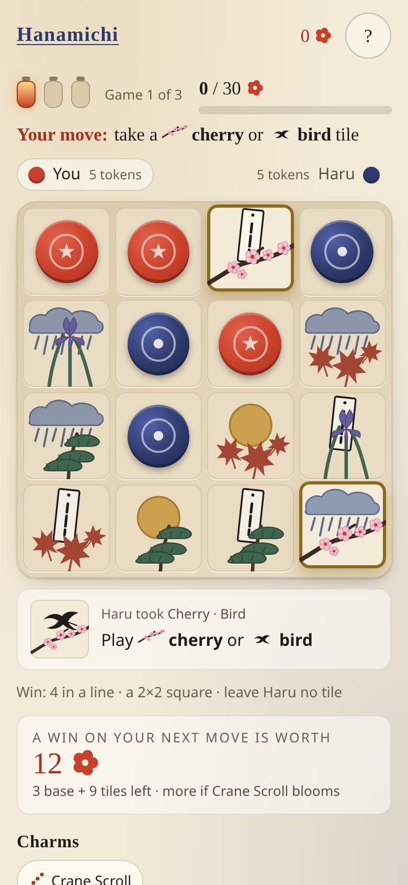

# Hanamichi — The Flower Road

A single-player web game built on the board game **Okiya** (a.k.a. Niya, by Bruno Cathala and
Cyril Bouquet, Blue Orange Games). Every game you play is a real, unmodified game of Okiya against
an AI rival. The new game is the road around it: six stations, three lanterns (games) at each,
a petal target to reach, and **charms** that decide how much each kind of victory is worth.

No backend, no account, no keys, no analytics: a static site that runs entirely in the browser
and remembers your road in `localStorage`.



## How to play

### Okiya, the game at the core

- The garden is a 4×4 square of 16 tiles: every pairing of a **vegetation** (maple, cherry, pine,
  iris) with a **symbol** (rising sun, poem, bird, rain).
- On your turn, take a tile and put one of your tokens in its place.
- The **first** tile of a game must come from the **outer border**; the four centre tiles are
  closed on move one.
- Every later tile must share the **vegetation or the symbol** of the tile your opponent just
  took. The card under the board always tells you what you may play ("play cherry or bird").
- You win at once with four of your tokens in a **row, column or diagonal**, or in a **2×2 square**,
  or when your opponent has **no legal tile** left (they are blocked). The official sheet does not
  say what happens when the last tile is taken without a formation; this game applies the blocking
  rule literally (the other player cannot move, so the last mover wins), so there are no draws. See
  [docs/RULES.md](docs/RULES.md).

### The Flower Road (the new layer)

- A **run** is six stations, each with a named rival. The rivals get stronger along the road.
- At each station you have **three lanterns**: three full games of Okiya. You need to gather the
  station's **petal target** before the lanterns run out. Clear it and you walk on; miss it and the
  road ends.
- A **won game** is worth 3 petals for the win, plus the official victory points (one per tile
  still in the garden), plus whatever your charms add. A lost game is worth nothing.
- **Charms** are drafted at the start and after each cleared station (hold up to four). They only
  read the finished game and never change the rules. Examples: *Stone Lantern* (+6 for a square
  win), *Crane Scroll* (+8 for a diagonal), *Thorn Hedge* (+4 for blocking the rival),
  *Corner Shrine* (+2 per corner held), *Rain Chain* (+1 per move that followed the constraint by
  symbol), *Narrow Gate* (+3 each time you leave the rival exactly one legal tile),
  *Swift Blossom* (×2 for winning with six tokens or fewer).
- The **Firefly** can be woken once per station. For one move it marks which legal tiles win at
  once and which hand the rival an immediate win. It only shows information.
- "**Today's road**" uses a seed derived from the date, so everyone gets the same gardens and
  charm offers that day. Your run autosaves after every move.

The official rules, as read from the Blue Orange print-and-play PDF, are summarised in
[docs/RULES.md](docs/RULES.md). How the game was designed, judged and tuned is in
[docs/DESIGN.md](docs/DESIGN.md); how it was built is in [docs/PROCESS.md](docs/PROCESS.md).

## Run it

Requires Node 20+.

```bash
npm install
npm run dev        # http://localhost:5173
```

```bash
npm test           # unit tests (rules engine, AI, charms, run flow, hints)
npm run build      # type-check + production build into dist/
npm run preview    # serve dist/ locally
```

Other scripts:

```bash
npm run sim -- 300 4 4           # AI-vs-AI Okiya simulation (games, depth P1, depth P2)
npx tsx scripts/sim-hanamichi.ts # playtest of the charm layer by simulation
npx tsx scripts/sim-koikoi.ts    # playtest of the runner-up idea
npm run screenshots              # phone/tablet/desktop screenshots into docs/screenshots/ (needs the dev server)
npm run e2e                      # Playwright flow check against the dev server (draft, release, resume, illegal clicks)
```

## Deploy

The build is a plain static site with relative asset paths (`base: './'`), so `dist/` can be
served from any static host or sub-path. For example:

- **GitHub Pages**: `npm run build`, then publish the `dist/` folder (e.g. with the
  `actions/upload-pages-artifact` + `actions/deploy-pages` actions, or by pushing `dist/` to a
  `gh-pages` branch).
- **Netlify / Vercel / Cloudflare Pages**: build command `npm run build`, publish directory `dist`.
- **Any web server / S3 bucket**: copy the contents of `dist/` to the document root.

There is nothing to configure: no environment variables, API keys or server code.

## Project layout

```
src/engine/okiya.ts     the official rules (pure, immutable state), with okiya.test.ts
src/engine/ai.ts        negamax AI with alpha-beta, transposition table, difficulty presets
src/engine/charms.ts    the charm layer: pure functions scoring a finished game
src/game/stations.ts    the six stations (rival strength, petal targets)
src/game/run.ts         run state machine (draft → station → games → result → next)
src/game/hints.ts       information-only helpers: Paper Lantern, "worth now", board hints
src/ui/                 framework-free UI: app.ts, board.ts, tileArt.ts (SVG tiles), styles.css
scripts/                simulations and the screenshot script
docs/                   rules summary, design record, judging, simulation outputs, reviews, screenshots
```

## Credits

Okiya/Niya is designed by Bruno Cathala and Cyril Bouquet and published by Blue Orange Games.
This project is an unofficial fan-made game that uses the published rules; all art here is original
CSS/SVG and no assets from the published game are used.
