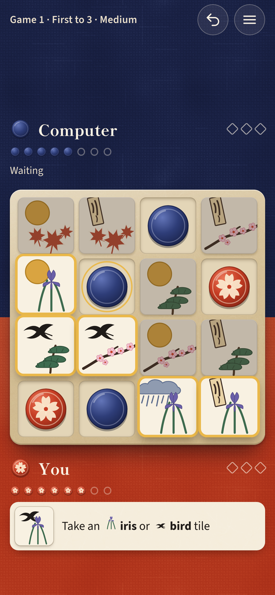

# Okiya

A digital edition of **Okiya**, the two-player garden game by Bruno Cathala and Cyril Bouquet,
played exactly by the official rules. Two people on one device, or one person against the
computer at three levels. Phones, tablets and desktops; portrait and landscape; works offline
once loaded. A static site with no backend, accounts, keys or tracking.



## How to play

Sixteen tiles lie in a 4 × 4 garden, each pairing a plant (maple, cherry, pine, iris) with a
symbol (rising sun, poem, bird, rain). On your turn you take one tile and put one of your tokens
in its place.

- The first tile of a game must come from the outer ring.
- Every tile after that must share the plant **or** the symbol of the tile your opponent just took.
- You win with four tokens in a row, a column or a diagonal, with a 2 × 2 square, or by leaving
  your opponent no tile they may take.
- If the garden is emptied with no winner, the game is a tie (the designer's ruling).
- Matches: a single game, first to 3 wins, or victory points (a win scores the tiles left in the
  garden) to 10, 15 or 20.

The full rules, their sources and the one interpretation this edition makes are in
[docs/RULES.md](docs/RULES.md); the game has an illustrated "How to play" sheet too.

## Run it

Requires Node 20 or newer.

```bash
npm install
npm run dev          # http://localhost:5173
npm test             # unit tests: rules engine, AI, match flow, rules-page diagrams
npm run build        # type-check, production build into dist/, service worker
npm run e2e          # end-to-end tests on 10 device profiles (needs `npx playwright install`)
```

Other scripts:

```bash
npm run sim -- calibrate 400   # difficulty ladder against three player models
npm run sim -- solve 24        # exact game value of random gardens with perfect play
npx tsx scripts/capture.ts     # screenshots and share image from a running build (vite preview)
npm run icons                  # PNG icons from public/icon.svg
```

## Deploy to Vercel

`vercel.json` declares everything: the Vite framework preset, `npm run build`, the `dist` output,
long-term caching for hashed assets, `no-cache` for the service worker, and security headers with
a Content Security Policy. Import the repository in Vercel (or run `vercel` / `vercel --prod`
from the project root) and accept the detected settings. There are no environment variables.

The same `dist/` works on any static host; asset paths are relative.

## Project layout

```
src/engine/okiya.ts   the official rules: pure functions, immutable state (+ tests)
src/engine/ai.ts      negamax search with alpha-beta; Easy / Medium / Hard presets (+ tests)
src/game/match.ts     a match: setup, games, undo, save/restore by replaying the engine (+ tests)
src/game/aiClient.ts  runs the computer's search in a Web Worker (ai.worker.ts)
src/ui/               framework-free UI: app shell, home, game screen, sheets, art, styles
e2e/                  Playwright end-to-end tests (gameplay, layout, offline, accessibility, CSP)
scripts/              simulation, service-worker build, icons, screenshots, Vercel-header server
docs/                 rules, process, evidence, screenshots
```

## Credits and licences

- **Okiya** (also published as **Niya**) is designed by Bruno Cathala and Cyril Bouquet and
  published by Blue Orange Games. This edition uses its rules; no Blue Orange artwork, logos or
  trade dress are used. Selling it under the name "Okiya" requires a licence from the rights
  holders (see docs/PROCESS.md, "Open items").
- **Art**: the garden tiles, tokens, icons and app icon are original SVG drawn for this project.
- **Sounds**: synthesised at run time with the Web Audio API; there are no audio files.
- **Typefaces**, both under the SIL Open Font License 1.1 and self-hosted (the licence texts ship
  with the site in `public/licenses/` and are linked from Settings → About):
  - Shippori Mincho B1 by the Shippori Mincho Project Authors (Fontdasu), for display, from the
    `@fontsource/shippori-mincho-b1` package;
  - Source Sans 3 by Adobe (Paul D. Hunt), for interface text, from `@fontsource/source-sans-3`.
- **Code**: the dependencies shipped to players are the two font packages only; everything else
  is development tooling.
